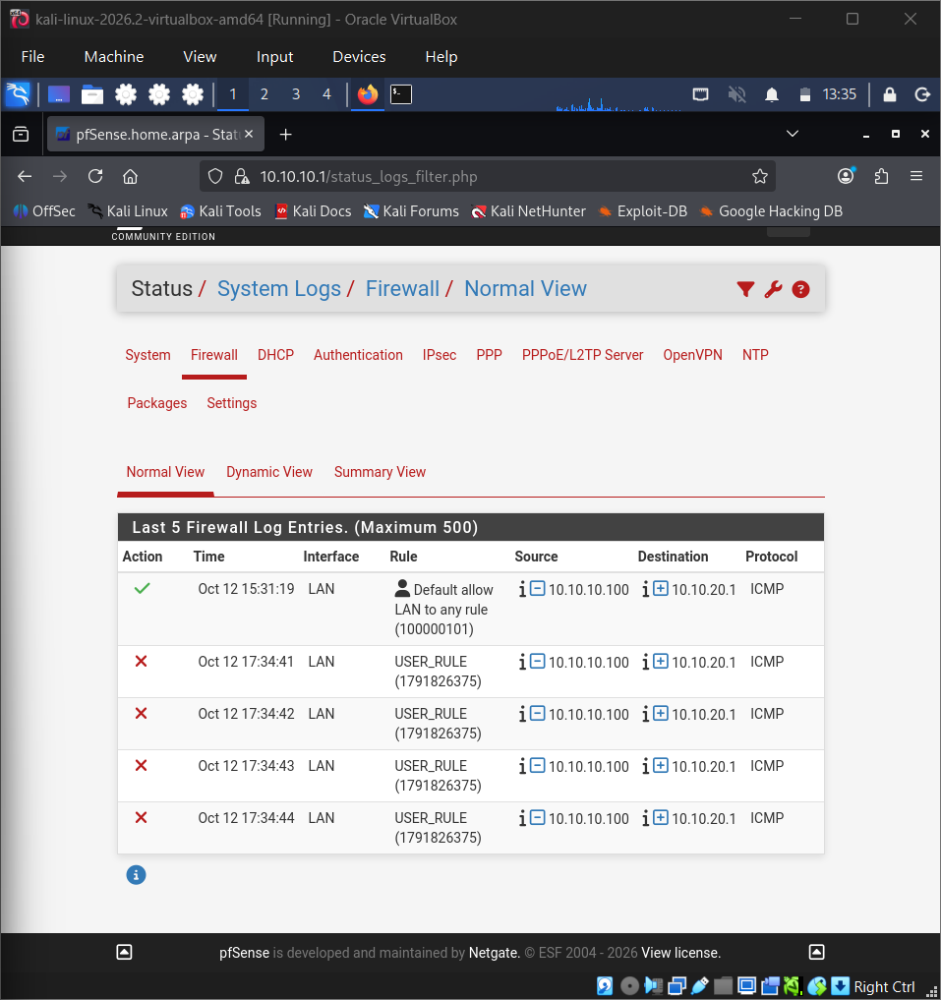

# SOC Case 01 — pfSense Blocked ICMP Traffic

## 1. Incident Overview

**Incident Type:** Firewall-blocked network traffic  
**Source:** Kali Linux — `10.10.10.100`  
**Destination:** pfSense DMZ — `10.10.20.1`  
**Protocol:** ICMP  
**Action:** Blocked  
**Detection Platform:** Wazuh SIEM  
**Firewall:** pfSense CE  
**Wazuh Rule:** `100100`  
**Severity:** Level 5

## 2. Objective

Validate end-to-end security monitoring by generating blocked network traffic through pfSense and detecting the resulting firewall event in Wazuh.

## 3. Test Scenario

A temporary pfSense firewall rule was configured to block ICMP traffic from the Kali Linux system (`10.10.10.100`) to the DMZ interface (`10.10.20.1`).

The following test was executed from Kali Linux:

```bash
ping -c 4 10.10.20.1
```

### Result

```text
4 packets transmitted, 0 received, 100% packet loss
```

This confirmed that the firewall rule was blocking the ICMP traffic.

## 4. Wazuh Detection

pfSense forwarded firewall events to the Wazuh manager through UDP/514.

A custom Wazuh decoder named `pfsense-raw` was created to process the pfSense BSD syslog format and extract the firewall action.

A custom Wazuh detection rule was then created:

```text
Rule ID: 100100
Level: 5
Description: pfSense firewall blocked network traffic
Group: pfsense, firewall, firewall_drop
```

The rule triggered when the decoded firewall action was:

```text
action = block
```

## 5. Alert Evidence

Wazuh generated four alerts from the four ICMP packets:

| Time | Source | Destination | Protocol | Action | Rule |
|---|---|---|---|---|---|
| 20:00:01 | 10.10.10.100 | 10.10.20.1 | ICMP | Block | 100100 |
| 20:00:02 | 10.10.10.100 | 10.10.20.1 | ICMP | Block | 100100 |
| 20:00:03 | 10.10.10.100 | 10.10.20.1 | ICMP | Block | 100100 |
| 20:00:04 | 10.10.10.100 | 10.10.20.1 | ICMP | Block | 100100 |

### Evidence




## 6. Detection Flow

```text
Kali Linux
10.10.10.100
      |
      | ICMP
      v
pfSense Firewall
10.10.10.1
      |
      | Block + Log
      | UDP/514
      v
Wazuh Manager
10.10.10.103
      |
      | Custom Decoder
      | pfsense-raw
      v
Rule 100100
Level 5
      |
      v
Wazuh Alert
```

## 7. Investigation Findings

The investigation confirmed:

- pfSense successfully blocked the ICMP traffic.
- pfSense generated firewall log events for the blocked packets.
- Events were successfully forwarded to Wazuh over UDP/514.
- Wazuh successfully decoded the pfSense event using the custom `pfsense-raw` decoder.
- The decoder extracted the firewall action as `block`.
- Wazuh Rule `100100` successfully detected the blocked traffic.
- Four corresponding alerts were visible in Wazuh Threat Hunting.

## 8. Analyst Assessment

**Verdict:** Expected / Controlled Security Test

This was an intentionally generated firewall-blocking event used to validate the SOC monitoring pipeline.

The test demonstrated visibility from network activity through firewall enforcement, centralized logging, SIEM decoding, rule-based detection, and alert generation.

## 9. Skills Demonstrated

- pfSense firewall configuration
- Firewall rule creation and testing
- Network traffic analysis
- Syslog / UDP 514
- Wazuh SIEM
- Wazuh custom decoder creation
- Wazuh custom detection rule creation
- Alert validation
- SOC investigation methodology
- Incident documentation
- Network security monitoring
